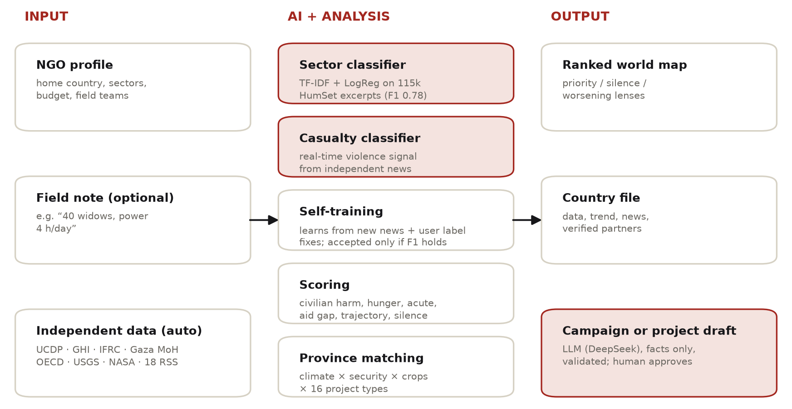
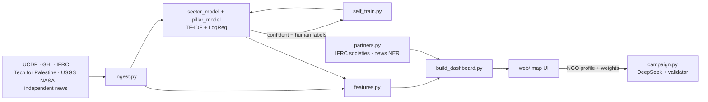
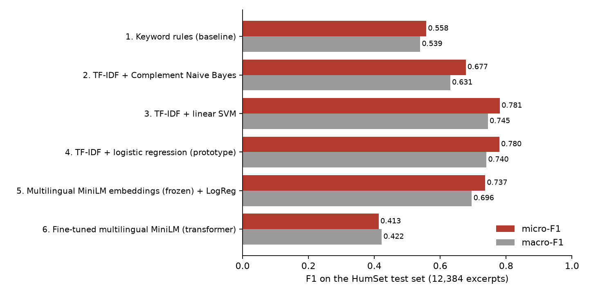
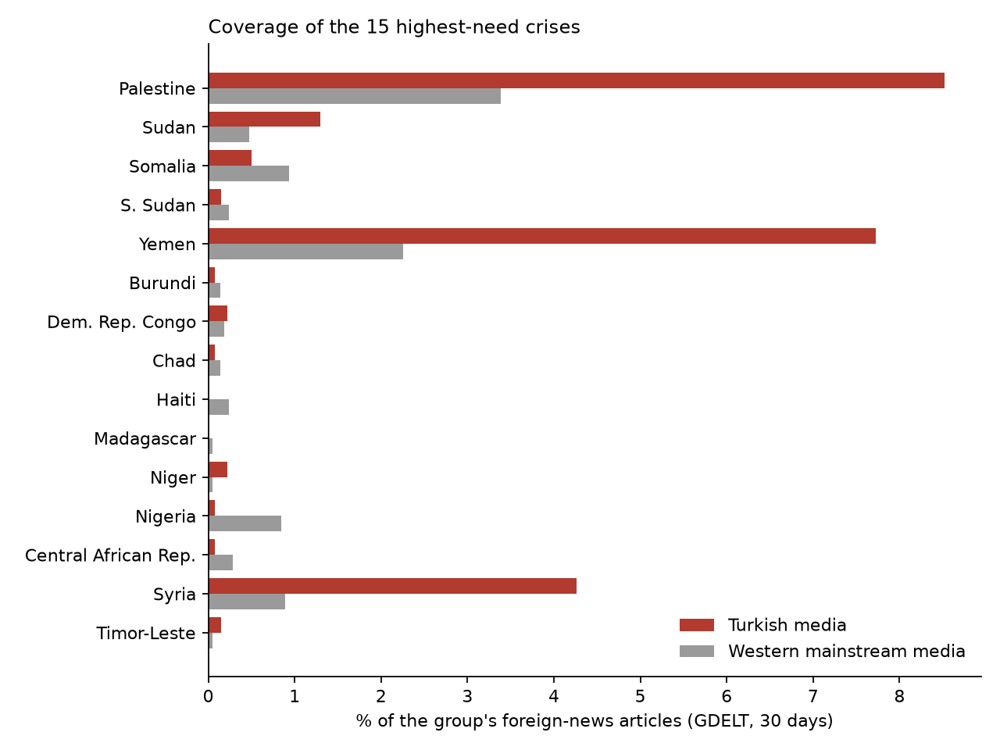
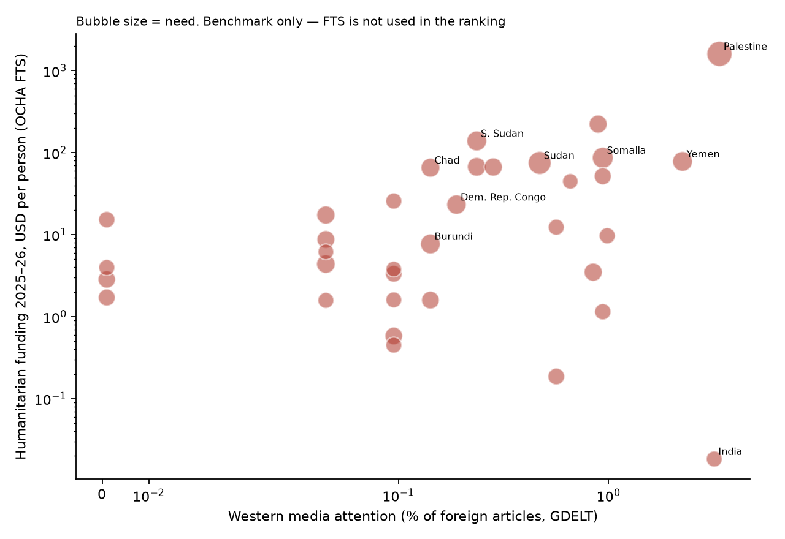

# STK Asistanı — AI crisis monitor & campaign recommender for NGOs

> **SDG 17.17 · 16.1 · 2.1 · 1.5 / 11.5** · Capstone "AI for the SDGs" · Group 6 (Tuna Bilgen, Ufuk Gündoğar)

**One sentence:** STK Asistanı helps NGOs anywhere in the world (first pilot users: small and medium NGOs in Türkiye; STK = *sivil toplum kuruluşu*, NGO in Turkish)
decide **where** to run their next aid campaign, **what** it should contain and **with whom** to
partner. It reads independent data and news continuously, classifies them with self-updating ML
models, and ranks acute, protracted and under-reported crises against the NGO's own sectors. The
results are shown on an interactive world map.



> The interface opens in English; switch to Turkish with the **TR** button (top right). Campaign and project drafts follow the interface language.

## Source independence

The project deliberately uses **no UN data**. Evidence comes from academic datasets, NGO indices,
the Red Cross / Red Crescent movement, open Gaza casualty data, science agencies and independent /
Global-South media. Western mainstream media (BBC, Guardian, NYT) are collected **only to measure
which crises they ignore**.

| Source | Publisher (type) | Used for |
|---|---|---|
| [UCDP GED 26.1 + candidate 2026](https://ucdp.uu.se/downloads/) | Uppsala University (academic) | conflict deaths 2016 → Aug 2026 |
| [Global Hunger Index 2026](https://www.globalhungerindex.org) | Concern Worldwide & Welthungerhilfe (NGOs) | hunger |
| [IFRC GO](https://go.ifrc.org) | Red Cross / Red Crescent movement | active appeals & funding gap, new emergencies, national societies (partners) |
| [Tech for Palestine](https://data.techforpalestine.org) | volunteer open data (Gaza Ministry of Health) | Gaza killed / injured / starvation deaths |
| [OECD DAC2A](https://data-explorer.oecd.org) | OECD (donor-reported statistics) | humanitarian aid per recipient → aid per person in need |
| [USGS](https://earthquake.usgs.gov), [NASA EONET](https://eonet.gsfc.nasa.gov) | science agencies | earthquakes, storms, floods, volcanoes |
| News RSS | Al Jazeera, Middle East Eye, Anadolu, Yeni Şafak, Daily Sabah, The New Arab, MEMO, Mondoweiss, Radio Dabanga, Ariana News, Amu TV, Dawn, Africanews, MSF, Amnesty | classifier input, real-time violence signal, self-training |
| News RSS (comparison only) | BBC, The Guardian, New York Times | Western-attention gap |
| [HumSet](https://huggingface.co/datasets/nlp-thedeep/humset) | DEEP / Data Friendly Space (Apache-2.0) | **training text only** for the classifiers |
| [Natural Earth](https://www.naturalearthdata.com) | public domain | map shapes |

Known coverage gaps are shown in the UI (e.g. GHI gives only provisional categories for Sudan, South Sudan, Yemen and Burundi, and does not cover Palestine). **Missing data is never scored as "no need".**

## Dataset (for reviewers)

| File | Content |
|---|---|
| [`data/final/country_crisis_dataset.csv`](data/final/country_crisis_dataset.csv) | **Final dataset:** 177 countries × 38 columns (raw indicators, normalised 0–1 components, scores, trend labels) |
| [`data/final/DATA_DICTIONARY.md`](data/final/DATA_DICTIONARY.md) | What each column means and how it is computed |
| [`data/final/news_labelled.csv`](data/final/news_labelled.csv) | News items with country tags, AI sector labels and casualty probability |
| [`notebooks/01_dataset_and_preprocessing.ipynb`](notebooks/01_dataset_and_preprocessing.ipynb) | **Every cleaning and transformation step with its outputs:** HumSet cleaning and label mapping; UCDP merge and Gaza re-assignment; Gaza MoH vs UCDP; GHI provisional categories; IFRC; OECD and the Türkiye–Syria correction; news tagging; missing-value rules; normalisation; sanity checks; model results |
| [`reports/eda_summary.md`](reports/eda_summary.md) + `reports/figures/` | EDA summary and figures |

Regenerate everything: `python -m src.ingest && python -m src.build_dashboard && python notebooks/make_notebook.py && jupyter nbconvert --to notebook --execute --inplace notebooks/01_dataset_and_preprocessing.ipynb`

## What it does

| Step | How |
|---|---|
| 1. Ingest | `src/ingest.py` downloads all sources above (structured weekly, live daily) |
| 2. Understand news | **Sector classifier** (TF-IDF + logistic regression on 115k HumSet excerpts) and a **crisis-dynamics classifier** (casualties / displacement / shock / access) |
| 3. Keep learning | **Self-training**: confident predictions on new articles + human corrections from the UI; a new model is accepted only if expert-test F1 holds |
| 4. Prioritise | Protracted suffering = half the worst civilian dimension (civilians killed per 100k or hunger) plus half the weighted mean of civilian harm (2), conflict intensity (1) and hunger (1.5). Acute = max(natural-hazard alert × vulnerability, where vulnerability = the higher of the hunger level (GHI does not score high-income countries, which have no hunger problem) and ongoing violence; an earthquake in a state that copes on its own, such as the USA, scores zero; a new IFRC appeal; recent violence from UCDP / Gaza MoH / news). Plus sector need, IFRC funding gap and an *ignored-by-Western-media* bonus. The user sets every weight |
| 4a. Aid gap | Humanitarian aid (OECD) **per person in severe need**, recognised crises only; Türkiye's refugee-hosting costs excluded from aid to Syria; documented starvation deaths override budgets (aid not delivered) |
| 4a. Trajectory | Last 3 months vs median of the 12 before and vs the previous quarter → **worsening / chronic / improving** (a drop while killing continues is never labelled as improvement); escalation is an additive bonus (never a penalty) and has its own lens |
| 4b. Silence lens | **Silence index** = need × (1 − Western-media visibility). One click re-ranks the map by the crises mainstream media leave unreported |
| 4c. Place-specific projects | Per **province** (Natural Earth admin-1): violence (UCDP events → nearest province), last year's climate and elevation (Open-Meteo ERA5), news naming the province. A crop–climate table (21 crops) and a catalogue of 16 sustainable project types (farmers' cooperative with seed bank, orchard, greenhouse, women's tailoring workshop, food processing, small livestock pass-on, beekeeping, solar well, vocational training, mobile clinic, …) are matched to each province by security, climate, sector and budget. The LLM drafts a full proposal (activities, procurement, training, sustainability and exit, timeline, budget split, KPIs, risks, what to verify on site), using an optional field note from the NGO |
| 5. Decide modality | Distance from home country and field-team countries → **direct** vs **partnership** (with an access-check note) |
| 6. Find partners | The country's **Red Crescent / Red Cross society** (verified, IFRC directory) + organisations named in independent news (unverified) + due-diligence checklist |
| 7. Draft campaign | **DeepSeek LLM** writes only from a FACTS block with named sources; the validator removes invented organisations and flags unsupported numbers; template fallback |



## Assignment 1 results

| model (HumSet test set) | micro-F1 | macro-F1 |
|---|---|---|
| keyword rules (baseline) | 0.558 | 0.539 |
| sector classifier, TF-IDF + logistic regression | **0.780** | **0.740** |
| crisis-dynamics classifier (4 pillars) | 0.662 | 0.640 (casualties 0.63) |

Language gap in macro-F1: EN 0.75, FR 0.72, **ES 0.62**.

Early attention-gap finding (30 days): BBC, Guardian and NYT give **38%** of their country-tagged world news to Ukraine and Russia
and **0%** to Sudan, DR Congo, Somalia, Syria and Lebanon. See [reports/eda_summary.md](reports/eda_summary.md).

## Assignment 2 — what changed and what we tried

**Video (2–3 min):** _link will be added here_ · Full numbers: [reports/model_comparison.json](reports/model_comparison.json),
[reports/multilingual_eval.json](reports/multilingual_eval.json), [reports/attention_analysis.json](reports/attention_analysis.json).

### Changes made after the Assignment 1 feedback

| feedback | what we did |
|---|---|
| Put the *silence* idea at the centre, simplify the rest | The app now opens on the **Silence** view. Silence is now **relative to need** (below). The yes/no "ignored" flag became a ratio: *"West: 10% of due coverage"*. |
| Use GDELT | Western attention now comes from **GDELT 2.0**: 30 days, 274,838 articles, 7,317 outlets (was ~90 RSS items from 3 outlets). |
| Use ReliefWeb and OCHA FTS | ReliefWeb was already a source. **OCHA FTS funding is used only as a benchmark** ("does UN money reach the crises the media ignore?"), never in the ranking, so the ranking stays independent of the UN system. |
| Add Turkish media and compare it with Western media | 8 Turkish outlets from across the political spectrum (TRT Haber, AA, Hürriyet, Yeni Şafak, Sabah, Cumhuriyet, BirGün, bianet) as RSS, plus 1,584 Turkish articles in GDELT. Comparison below. |
| Test the classifier on Turkish and Arabic | New EN/TR/AR test set and a **language router** in the app (below). |
| Interview 2–3 NGOs | We could not arrange interviews in this period. In Assignment 3 we replace them with structured **persona tests** (small Turkish NGO, international NGO, journalist, donor) and say clearly that this is a weaker form of user validation. |
| Discuss ranking sensitivity | Planned for the Assignment 3 report; the weight sliders and the GDELT-vs-RSS check below are the first step. |

### Models tried for the sector classifier

Same data (HumSet, 10 sectors, multi-label), same official test split (**12,384 expert-labelled excerpts**), and the same
rule for every learned model: per-class thresholds tuned on the validation split. Code: [src/compare_models.py](src/compare_models.py).

| # | approach | micro-F1 | macro-F1 | note |
|---|---|---|---|---|
| 1 | keyword rules | 0.558 | 0.539 | no learning, baseline |
| 2 | TF-IDF + Complement Naive Bayes | 0.677 | 0.631 | |
| 3 | TF-IDF + linear SVM | **0.781** | **0.745** | best, but no calibrated probabilities |
| 4 | TF-IDF + logistic regression | 0.780 | 0.740 | **used in the app** (EN/FR/ES) |
| 5 | multilingual sentence embeddings (frozen MiniLM) + LogReg | 0.737 | 0.696 | **used in the app** (TR/AR) |
| 6 | fine-tuned multilingual MiniLM | 0.413 | 0.422 | CPU only: 12k excerpts, 2 epochs, 73 min |
| 7 | LLM zero-shot (DeepSeek V4.1 Flash, free) | 0.818 | 0.717 | **preliminary, 37 excerpts** (free-tier limit); model 4 on the same 37: 0.718 / 0.594 |



**Why the linear models win here.** HumSet excerpts are long and full of sector words (*cholera, latrine, school*), so word
n-grams already carry most of the signal; with 100k+ labelled training excerpts a linear model learns them well and
retrains in about a minute. SVM and logistic regression are tied (0.781 vs 0.780); we keep logistic regression because it gives
probabilities, which the dashboard and the self-training step need. The frozen sentence-embedding model loses ~4 points
because it compresses each excerpt into one 384-number vector. The fine-tuned transformer did badly **because of our
compute budget, not the method**: on a laptop CPU we could only train on 10% of the data for 2 epochs, and the loss was still
falling. We report it as a negative result instead of hiding it.

**The LLM.** On the first 37 test excerpts (the free OpenCode model stopped with a usage limit after that), the LLM with no
training beat our model on the same excerpts by about 10 points (micro-F1 0.82 vs 0.72). 37 is too few to be sure; the run
resumes from its cache (`python -m src.compare_models llm`) and we will report all 200 in Assignment 3. Even if the LLM is
more accurate, it is too slow and rate-limited to label thousands of news items a day, so the app uses it only for drafting
campaigns, where a human checks the output.

### Turkish and Arabic

HumSet has no Turkish or Arabic text, so we machine-translated 300 English test excerpts with open OPUS-MT models
(labels carry over; the excerpts were never seen in training). Code: [src/multilingual_eval.py](src/multilingual_eval.py).

| micro-F1 | English | Turkish | Arabic |
|---|---|---|---|
| keyword rules | 0.599 | 0.151 | 0.047 |
| TF-IDF + LogReg (Assignment 1 model) | **0.792** | 0.336 | 0.200 |
| multilingual embeddings + LogReg | 0.732 | **0.699** | **0.704** |
| **app: language router** | **0.792** | **0.695** | **0.704** |

The Assignment 1 model **could not read Turkish or Arabic** (0.34 / 0.20). The app now detects the language and sends
EN/FR/ES text to TF-IDF and Turkish/Arabic text to the multilingual model, so it keeps the best score in every language
([src/sector_model.py](src/sector_model.py) `predict`). Limitation: the test texts are machine translations, which are cleaner than
real Turkish or Arabic news.

### Need-relative silence

Assignment 1 used *need × (1 − attention)*. That treats 10 articles about a catastrophe the same as 10 articles about a small
crisis. Now each crisis is compared with its **fair share** of coverage:

```
coverage_ratio = (country's share of Western foreign news) / (country's share of total need)
silence        = need × (1 − min(coverage_ratio, 1))
```

A ratio of 1 means the crisis gets the coverage its need deserves; 0.1 means it gets 10%. Home-country news (USA, GBR) is excluded.
Stories whose URL names a place (e.g. *gaza*) are counted for that place even if GDELT's geocoder put them elsewhere (see below).

Top of the ranking now: **Sudan** (10% of due coverage), Burundi, South Sudan, DR Congo, Somalia, Chad, Madagascar, Niger, Haiti,
Timor-Leste. Palestine: 59% of due coverage. Ukraine: 346%.

### Media attention vs need vs funding (GDELT + OCHA FTS)

Code: [src/attention_analysis.py](src/attention_analysis.py), 35 countries with high protracted need.

* **Does attention follow need?** Only weakly. Spearman ρ = 0.25 for Western media, 0.29 for Turkish media, 0.14 for all GDELT outlets (none significant at 5%).
* **Turkish vs Western media.** Turkish outlets give **33%** of their foreign news to these crises, Western outlets **19%**.

  
* **Is the small RSS sample from Assignment 1 confirmed?** Mostly yes: attention ρ = 0.66, silence ranking ρ = 0.80, 8 of the top 10 the same.
* **Does UN funding reach the silent crises?** Funding per person follows need (ρ = 0.59). Controlling for need, more Western attention goes with
  somewhat more funding (partial ρ = 0.28, p = 0.10, not significant). The quiet half of crises gets a median **$3.9 per person**, the
  visible half **$51.6**, but the visible half also has higher need, so this is a hint, not proof.

  
* **Where is Gaza?** Of stories whose URL names Gaza/Palestine, GDELT located 90% (Western), 96% (Turkish) and 90% (other) **only in Israel**.
  Because the rate is about the same for every group, this is mainly a geocoder effect, not Western bias; but it means any tool that trusts
  GDELT's locations will under-count Palestine. We correct for it. *How* outlets describe the crisis (framing) is our Assignment 3 topic.

### LLM set-up (no API key in the repository)

The campaign and project drafts use **DeepSeek V4.1 Flash**. The default is the free model on **OpenCode Zen**, called through the
official OpenCode command-line tool (`opencode run`), so the repository contains no key at all:

1. Install **OpenCode Desktop** (opencode.ai) or the CLI (`npm i -g opencode-ai`). On Windows the app finds the CLI
   bundled with the desktop app automatically; elsewhere set `OPENCODE_BIN` if `opencode` is not on PATH.
2. Put `LLM_ENGINE=opencode` in `.env`. The free model needed no login in our tests; for paid models run `opencode auth login`.

Alternatives in [.env.example](.env.example): OpenCode Go or OpenRouter (key in your local `.env`, which git ignores).
Without any LLM the app falls back to a template.

## Run it

```bash
pip install -r requirements.txt
copy .env.example .env            # choose an LLM option (optional, see above)
python -m src.download_humset      # training data (HumSet, ~125 MB)
python -m src.ingest              # downloads all sources (~3 min)
python -m src.sector_model train  # ~5 min
python -m src.pillar_model train  # ~3 min
python -m src.build_dashboard
python app.py                     # → http://localhost:8000
```

For a daily refresh run `python update.py`; add `--full` once a week.

**LLM:** see *LLM set-up* above. Without an LLM the app uses a template.

## Ethics (summary)

* **Source bias.** Any single institutional data ecosystem has blind spots. We use multiple independent sources, name the source of every figure, and expose data gaps instead of hiding them.
* **Audit lesson.** An earlier version built on a single institutional ecosystem under-ranked Gaza. The causes were inflated funding figures, missing data scored as zero, and conflicts not counted as acute. Ranking audits against domain knowledge are now part of our test plan.
* **Western-attention metric.** Since Assignment 2 it comes from GDELT (24 Western outlets, 30 days). The list of "Western" outlets is our choice and is listed in `src/sources/gdelt.py`; the coverage ratio is an indicator, not a verdict.
* **Geocoder bias.** GDELT places most Gaza stories in Israel. We re-attribute stories by the place named in the URL, with the same rule for every country.
* **Gazetteer tagging.** Demonyms are used only when no place is named, so reports are attributed to the place where people are affected. A known limitation: "Afghan returnees from Pakistan" is tagged as Pakistan only.
* **Language bias.** The classifier is weaker on Spanish (macro-F1 0.62). Turkish and Arabic go to a multilingual model (micro-F1 ≈ 0.70, measured on machine translations). We report per-language F1.
* **Self-training drift.** Pseudo-labels are capped and require high confidence; an F1 guard applies; human corrections win.
* **Hallucination.** The LLM is fact-restricted and its output validated; a human must approve every campaign.
* **NGO country policy.** The profile has an *excluded countries* setting (default: Israel, the project team's choice). Excluded countries are shown grey with the label "out of scope by NGO policy". The underlying data is not altered, so the choice stays transparent.
* **Partners are candidates.** Organisations named in news are marked *unverified*; a due-diligence checklist is always shown.

## Repository layout

```
app.py                 Flask server + API
update.py              daily pipeline
src/config.py          paths, sector taxonomy, env
src/sources/           independent.py (UCDP, GHI, IFRC, T4P, EONET), news.py (RSS + gazetteer), live.py (USGS)
src/ingest.py          download everything
src/sector_model.py    sector classifier
src/pillar_model.py    casualties / displacement / shock / access classifier
src/self_train.py      pseudo-label + human-feedback retraining with F1 guard
src/features.py        country indicators & scores
src/partners.py        Red Crescent societies + news-mentioned organisations
src/campaign.py        LLM campaign + project writer, validator, template fallback
src/regions.py         province profiles (violence, climate, elevation, news)
src/catalog.py         crop–climate table + sustainable project catalogue + matching
src/build_dashboard.py → web/data/dashboard.json
src/eda.py             figures + reports/eda_summary.md
web/                   MapLibre GL map UI
docs/                  concept note (PDF)
```
