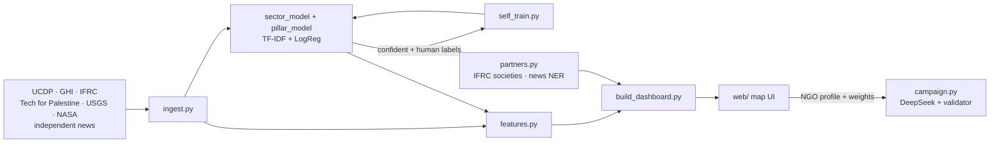

# STK Asistanı — AI crisis monitor & campaign recommender for NGOs

> **SDG 17.17 · 16.1 · 2.1 · 1.5 / 11.5** · Capstone "AI for the SDGs" · Group 6 (Tuna Bilgen, Ufuk Gündoğar)

**One sentence:** STK Asistanı helps small and medium Turkish NGOs (STK = *sivil toplum kuruluşu*)
decide **where** to run their next aid campaign, **what** it should contain and **with whom** to
partner. It reads independent data and news continuously, classifies them with self-updating ML
models, and ranks acute, protracted and under-reported crises against the NGO's own sectors. The
results are shown on an interactive world map.

## Source independence

The project deliberately uses **no UN data**. Evidence comes from academic datasets, NGO indices,
the Red Cross / Red Crescent movement, open Gaza casualty data, science agencies and independent /
Global-South media. Western mainstream media (BBC, Guardian, NYT) are collected **only to measure
which crises they ignore**.

| Source | Publisher (type) | Used for |
|---|---|---|
| [UCDP GED 26.1 + candidate 2026](https://ucdp.uu.se/downloads/) | Uppsala University (academic) | conflict deaths 2016 → Aug 2026 |
| [Global Hunger Index 2026](https://www.globalhungerindex.org) | Concern Worldwide & Welthungerhilfe (NGOs) | hunger |
| [IFRC GO](https://go.ifrc.org) | Red Cross / Red Crescent movement | active appeals & funding gap, new emergencies, national societies (partners) |
| [Tech for Palestine](https://data.techforpalestine.org) | volunteer open data (Gaza Ministry of Health) | Gaza killed / injured / starvation deaths |
| [OECD DAC2A](https://data-explorer.oecd.org) | OECD (donor-reported statistics) | humanitarian aid per recipient → aid per person in need |
| [USGS](https://earthquake.usgs.gov), [NASA EONET](https://eonet.gsfc.nasa.gov) | science agencies | earthquakes, storms, floods, volcanoes |
| News RSS | Al Jazeera, Middle East Eye, Anadolu, Yeni Şafak, Daily Sabah, The New Arab, MEMO, Mondoweiss, Radio Dabanga, Ariana News, Amu TV, Dawn, Africanews, MSF, Amnesty | classifier input, real-time violence signal, self-training |
| News RSS (comparison only) | BBC, The Guardian, New York Times | Western-attention gap |
| [HumSet](https://huggingface.co/datasets/nlp-thedeep/humset) | DEEP / Data Friendly Space (Apache-2.0) | **training text only** for the classifiers |
| [Natural Earth](https://www.naturalearthdata.com) | public domain | map shapes |

Known coverage gaps are shown in the UI (e.g. GHI gives only provisional categories for Sudan, South Sudan, Yemen and Burundi, and does not cover Palestine). **Missing data is never scored as "no need".**

## Dataset (for reviewers)

| File | Content |
|---|---|
| [`data/final/country_crisis_dataset.csv`](data/final/country_crisis_dataset.csv) | **Final dataset:** 177 countries × 38 columns (raw indicators, normalised 0–1 components, scores, trend labels) |
| [`data/final/DATA_DICTIONARY.md`](data/final/DATA_DICTIONARY.md) | What each column means and how it is computed |
| [`data/final/news_labelled.csv`](data/final/news_labelled.csv) | News items with country tags, AI sector labels and casualty probability |
| [`notebooks/01_dataset_and_preprocessing.ipynb`](notebooks/01_dataset_and_preprocessing.ipynb) | **Every cleaning and transformation step with its outputs:** HumSet cleaning and label mapping; UCDP merge and Gaza re-assignment; Gaza MoH vs UCDP; GHI provisional categories; IFRC; OECD and the Türkiye–Syria correction; news tagging; missing-value rules; normalisation; sanity checks; model results |
| [`reports/eda_summary.md`](reports/eda_summary.md) + `reports/figures/` | EDA summary and figures |

Regenerate everything: `python -m src.ingest && python -m src.build_dashboard && python notebooks/make_notebook.py && jupyter nbconvert --to notebook --execute --inplace notebooks/01_dataset_and_preprocessing.ipynb`

## What it does

| Step | How |
|---|---|
| 1. Ingest | `src/ingest.py` downloads all sources above (structured weekly, live daily) |
| 2. Understand news | **Sector classifier** (TF-IDF + logistic regression on 115k HumSet excerpts) and a **crisis-dynamics classifier** (casualties / displacement / shock / access) |
| 3. Keep learning | **Self-training**: confident predictions on new articles + human corrections from the UI; a new model is accepted only if expert-test F1 holds |
| 4. Prioritise | Protracted suffering = half the worst civilian dimension (civilians killed per 100k or hunger) plus half the weighted mean of civilian harm (2), conflict intensity (1) and hunger (1.5). Acute = max(natural-hazard alert × vulnerability, where vulnerability = the higher of the hunger level (GHI does not score high-income countries, which have no hunger problem) and ongoing violence; an earthquake in a state that copes on its own, such as the USA, scores zero; a new IFRC appeal; recent violence from UCDP / Gaza MoH / news). Plus sector need, IFRC funding gap and an *ignored-by-Western-media* bonus. The user sets every weight |
| 4a. Aid gap | Humanitarian aid (OECD) **per person in severe need**, recognised crises only; Türkiye's refugee-hosting costs excluded from aid to Syria; documented starvation deaths override budgets (aid not delivered) |
| 4a. Trajectory | Last 3 months vs median of the 12 before and vs the previous quarter → **worsening / chronic / improving** (a drop while killing continues is never labelled as improvement); escalation is an additive bonus (never a penalty) and has its own lens |
| 4b. Silence lens | **Silence index** = need × (1 − Western-media visibility). One click re-ranks the map by the crises mainstream media leave unreported |
| 4c. Place-specific projects | Per **province** (Natural Earth admin-1): violence (UCDP events → nearest province), last year's climate and elevation (Open-Meteo ERA5), news naming the province. A crop–climate table (21 crops) and a catalogue of 16 sustainable project types (farmers' cooperative with seed bank, orchard, greenhouse, women's tailoring workshop, food processing, small livestock pass-on, beekeeping, solar well, vocational training, mobile clinic, …) are matched to each province by security, climate, sector and budget. The LLM drafts a full proposal (activities, procurement, training, sustainability and exit, timeline, budget split, KPIs, risks, what to verify on site), using an optional field note from the NGO |
| 5. Decide modality | Distance from home country and field-team countries → **direct** vs **partnership** (with an access-check note) |
| 6. Find partners | The country's **Red Crescent / Red Cross society** (verified, IFRC directory) + organisations named in independent news (unverified) + due-diligence checklist |
| 7. Draft campaign | **DeepSeek LLM** writes only from a FACTS block with named sources; the validator removes invented organisations and flags unsupported numbers; template fallback |



## Results so far

| model (HumSet test set) | micro-F1 | macro-F1 |
|---|---|---|
| keyword rules (baseline) | 0.558 | 0.539 |
| sector classifier, TF-IDF + logistic regression | **0.780** | **0.740** |
| crisis-dynamics classifier (4 pillars) | 0.662 | 0.640 (casualties 0.63) |

Language gap in macro-F1: EN 0.75, FR 0.72, **ES 0.62**.

Early attention-gap finding (30 days): BBC, Guardian and NYT give **38%** of their country-tagged world news to Ukraine and Russia
and **0%** to Sudan, DR Congo, Somalia, Syria and Lebanon. See [reports/eda_summary.md](reports/eda_summary.md).

## Run it

```bash
pip install -r requirements.txt
copy .env.example .env            # add an OpenRouter key for the LLM (optional)
python -m src.ingest              # downloads all sources (~3 min)
python -m src.sector_model train  # ~5 min
python -m src.pillar_model train  # ~3 min
python -m src.build_dashboard
python app.py                     # → http://localhost:8000
```

HumSet must first be placed in `data/raw/humset/` (`train/validation/test.jsonl` from Hugging Face).
For a daily refresh run `python update.py`; add `--full` once a week.

**LLM:** any OpenAI-compatible endpoint. The default is OpenRouter with `deepseek/deepseek-v4.1-flash`
(≈ $0.001 per campaign), falling back to free models if it is unavailable. Without a key the app uses a template.

## Ethics (summary)

* **Source bias.** Any single institutional data ecosystem has blind spots. We use multiple independent sources, name the source of every figure, and expose data gaps instead of hiding them.
* **Audit lesson.** An earlier version built on a single institutional ecosystem under-ranked Gaza. The causes were inflated funding figures, missing data scored as zero, and conflicts not counted as acute. Ranking audits against domain knowledge are now part of our test plan.
* **Western-attention metric.** It is computed from a small, growing sample of 3 outlets and is shown as an indicator, not a verdict.
* **Gazetteer tagging.** Demonyms are used only when no place is named, so reports are attributed to the place where people are affected. A known limitation: "Afghan returnees from Pakistan" is tagged as Pakistan only.
* **Language bias.** The classifier is weaker on Spanish (macro-F1 0.62). We report per-language F1.
* **Self-training drift.** Pseudo-labels are capped and require high confidence; an F1 guard applies; human corrections win.
* **Hallucination.** The LLM is fact-restricted and its output validated; a human must approve every campaign.
* **NGO country policy.** The profile has an *excluded countries* setting (default: Israel, the project team's choice). Excluded countries are shown grey with the label "out of scope by NGO policy". The underlying data is not altered, so the choice stays transparent.
* **Partners are candidates.** Organisations named in news are marked *unverified*; a due-diligence checklist is always shown.

## Repository layout

```
app.py                 Flask server + API
update.py              daily pipeline
src/config.py          paths, sector taxonomy, env
src/sources/           independent.py (UCDP, GHI, IFRC, T4P, EONET), news.py (RSS + gazetteer), live.py (USGS)
src/ingest.py          download everything
src/sector_model.py    sector classifier
src/pillar_model.py    casualties / displacement / shock / access classifier
src/self_train.py      pseudo-label + human-feedback retraining with F1 guard
src/features.py        country indicators & scores
src/partners.py        Red Crescent societies + news-mentioned organisations
src/campaign.py        LLM campaign + project writer, validator, template fallback
src/regions.py         province profiles (violence, climate, elevation, news)
src/catalog.py         crop–climate table + sustainable project catalogue + matching
src/build_dashboard.py → web/data/dashboard.json
src/eda.py             figures + reports/eda_summary.md
web/                   MapLibre GL map UI
docs/                  concept note (PDF)
```
