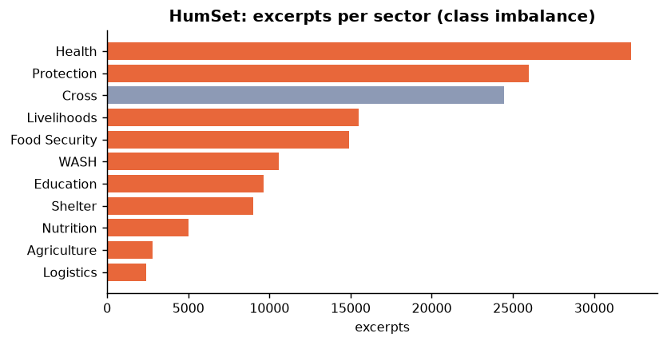
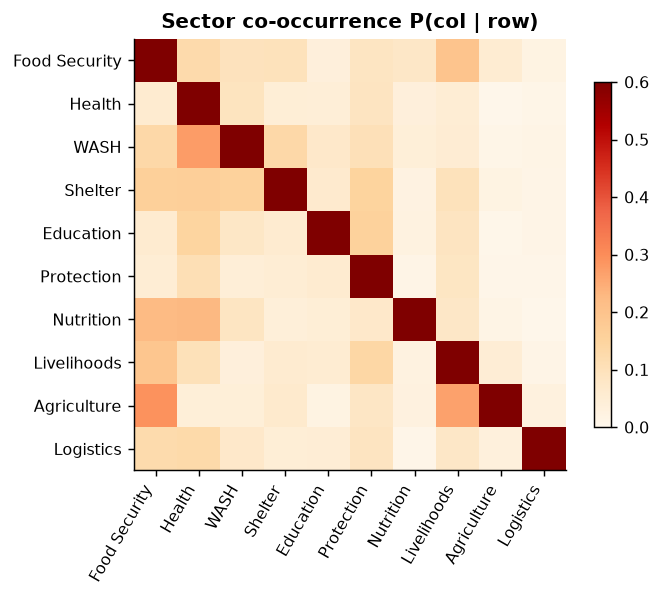
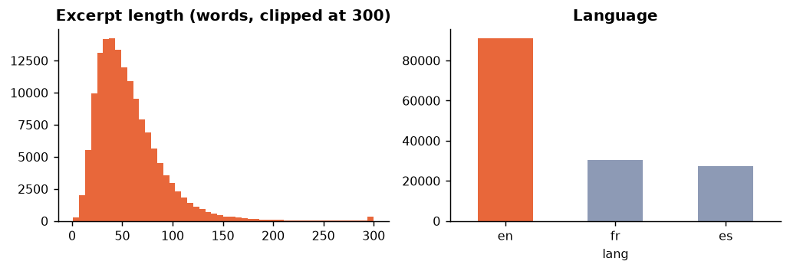
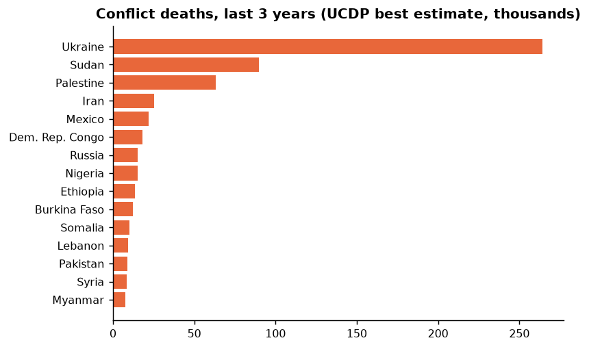
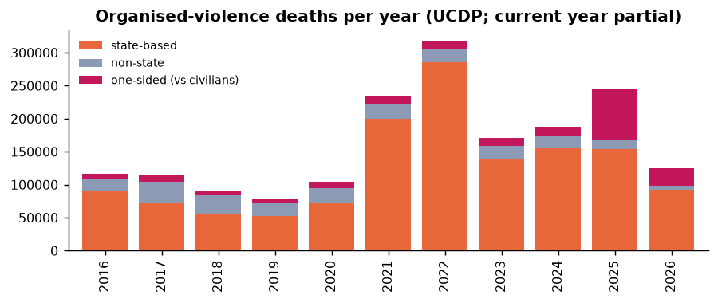
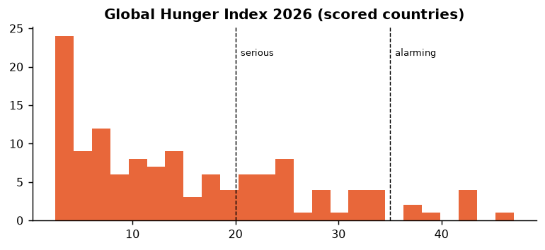
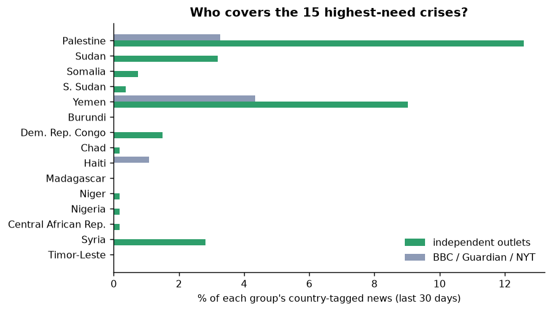
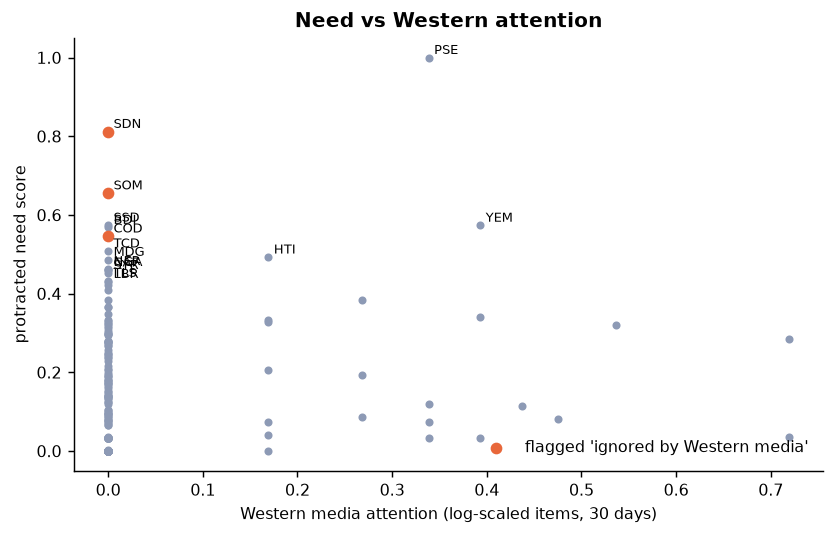
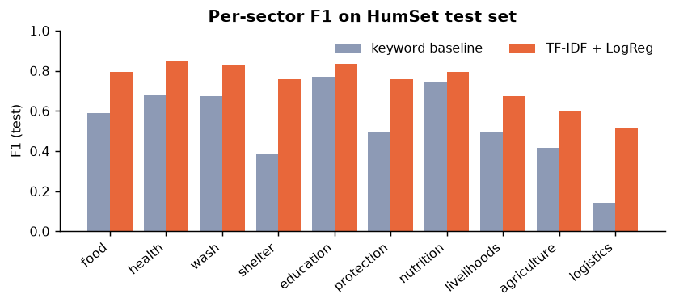

# EDA summary (auto-generated)

## 1. HumSet (training data for the sector classifier)

- Rows: **148,621** excerpts from 16,857 documents, 46 humanitarian response projects.
- Languages: {'en': 91134, 'fr': 30268, 'es': 27219}
- Missing/empty excerpt: 0; duplicated excerpts: 2,057
- Excerpts **without any sector label**: 22.5% (dropped for training — annotators tagged only pillars there).
- Labels per labelled excerpt: mean 1.32, max 11 → genuinely multi-label.
- Excerpt length (words): median 49, 95th pct 116

Imbalance ratio largest/smallest sector: **13×** (Health vs Logistics) → class weighting + per-class thresholds.

Strongest co-occurrences: Agriculture→Food Security 29%; WASH→Health 28%; Agriculture→Livelihoods 27%

- Annotation years: {'2018': 4621, '2019': 27274, '2020': 113289, '2021': 3437} → older crises dominate; live news may drift (motivates self-training).

## 2. Independent (non-UN) crisis data

| source                                         |   rows |   countries | period                  |
|:-----------------------------------------------|-------:|------------:|:------------------------|
| UCDP GED 26.1 + candidate 2026 (Uppsala Univ.) | 210115 |         109 | 2016 – 2026-08-31       |
| Global Hunger Index 2026                       |    130 |         130 | 2021–2026 data          |
| IFRC GO active appeals                         |    164 |          79 | active today            |
| IFRC national societies                        |    220 |         220 | current                 |
| Tech for Palestine (Gaza MoH daily)            |   1104 |           1 | 2023-10-07 – 2026-10-14 |

→ **Coverage gaps**: GHI gives only provisional categories for Sudan, South Sudan, Yemen, Burundi (used at range midpoint) and does not cover Palestine (starvation deaths from Gaza MoH data used instead); GHI does not score every country (e.g. Palestine); UCDP codes Gaza events under Israel (we re-assign them by admin-1). Gaps are recorded in `data/known_gaps.json` and shown in the UI; missing data is never scored as 'no need'.

- Top conflict-death countries (3 y): Ukraine 264,002, Sudan 89,846, Palestine 63,232, Iran 25,141, Mexico 21,824, Dem. Rep. Congo 18,073

- GHI ≥ 20 (serious or worse): **44** countries; ≥ 35 (alarming): 8

- IFRC active appeals: 164 (35 emergency appeals), requested CHF 2,236M, funded **51%**

## 3. News: independent vs Western coverage, and resulting scores

- News items collected: **644** from 18 outlets (506 independent, 138 Western); 74% tagged with ≥1 country by the gazetteer.

- The 15 highest-need countries receive **31%** of independent coverage but **9%** of Western coverage.

Flagged as ignored by Western media: Dem. Rep. Congo, Somalia, Sudan

## 4. Models

| model                  |   micro-F1 |   macro-F1 |
|:-----------------------|-----------:|-----------:|
| keyword baseline       |     0.5578 |     0.5392 |
| tfidf+logreg (t=0.5)   |     0.7793 |     0.7439 |
| tfidf+logreg (tuned t) |     0.7795 |     0.7393 |

By language (fairness check): {'en': {'n': 7501, 'micro_f1': 0.7963, 'macro_f1': 0.7462}, 'es': {'n': 2292, 'micro_f1': 0.7363, 'macro_f1': 0.6212}, 'fr': {'n': 2591, 'micro_f1': 0.7687, 'macro_f1': 0.714}}

Crisis-dynamics (pillar) model: macro-F1 0.6395, per class {'Casualties': 0.627, 'Displacement': 0.745, 'Shock/Event': 0.592, 'Humanitarian Access': 0.593}
